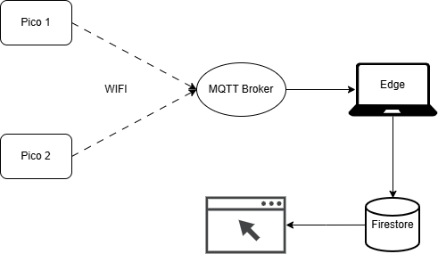
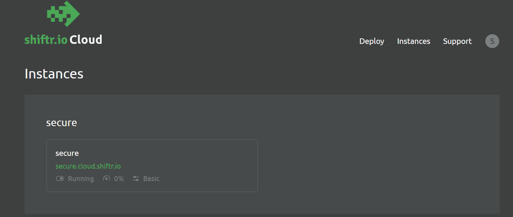
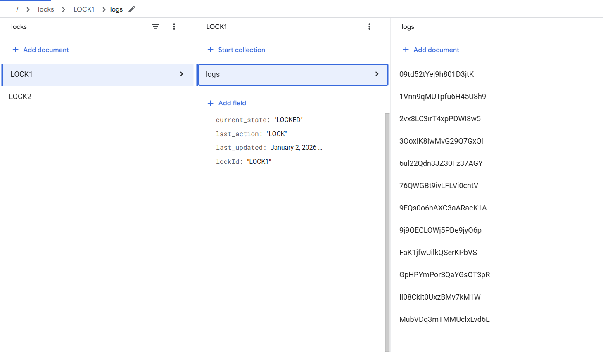
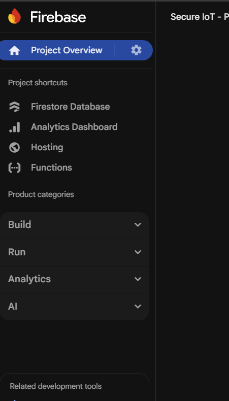
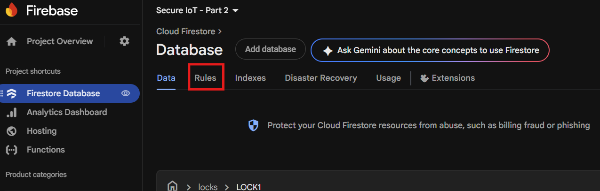

# Edge and Cloud

You can find the starter code for this part [here](https://github.com/purs3lab/ECE59500-130-iot/tree/part3). Submit an `answers.txt` file with answers to the descriptive questions that you will find throughout this part (Q1 to Q13).

In this step, we will add an edge and a cloud component to our setup. The circuit will remain the same as part1.  

Note that we will duplicate part1 twice, so we have two picos talking to the edge at the same time. Flash a second Pico with your part1 lock code, but give it its own identity: `CLIENT_ID` and `LOCKID` in `common.py` must both be unique per device (the broker will boot a client if another one connects with the same `CLIENT_ID`, so changing only `LOCKID` isn't enough). Point the second device at the same broker and the same Firebase/GCP project as the first; `edge.py` and the webapp should already key everything off `lockid`, so once both devices are publishing you should see two locks show up on the dashboard (Once you implement the dashboard). The cloud controller you build in [Controller-via-cloud](#controller-via-cloud) can pair with and control both locks.

We will use a laptop as our edge device. In this project, the edge will just act as a relay to send messages from the Picos to the cloud. But in a real-world situation, in most cases, edge will do additional processing that pico cannot due to pico's resource limitations. 

Overall communication flow is given below:



We have divided this part into three:
- Getting [MQTT](#mqtt) and [Edge](#edge) working
- Setting up and getting the [cloud](#cloud) part working
- Create a [webapp](#webapp) to view the logs

Once those three are working end to end, we add [device attestation](#attestation) on top, so `edge.py`/the dashboard can tell a genuine device's messages apart from anything else publishing to the shared broker.

Finally, we replace part2's BLE controller with one that talks to the device through the cloud instead of directly - see [Controller-via-cloud](#controller-via-cloud).

Once everything works, you threat-model the whole system with Threagile - see [Threat modeling with Threagile](#threat-modeling-with-threagile).

### MQTT

For the communication, we will be using the MQTT protocol since this is one of the most commonly used communication protocols in IoT settings. Read more about how MQTT works [here](https://www.geeksforgeeks.org/computer-networks/introduction-of-message-queue-telemetry-transport-protocol-mqtt/), [here](https://aws.amazon.com/what-is/mqtt/) and [here](https://www.emqx.com/en/blog/the-easiest-guide-to-getting-started-with-mqtt).

We will be using the MQTT client implementation that Micropython provides for our pico. To get this, download [this](https://github.com/micropython/micropython-lib/blob/master/micropython/umqtt.simple/umqtt/simple.py) file and upload it to your pico. 

Before we can communicate with the Edge, we need to have an MQTT broker in place. To do this, use [shiftr](https://cloud.shiftr.io/) or any other free online broker. Once you sign up for shiftr, you will get a free instance. You will see something like this:



#### shiftr
You will be asked to sign in with your shiftr account to access the instance. Once you are signed in, get your username and password:
- Go to the instance settings and generate a new token
    - Give it full access and copy the displayed secret. This will be the password we will use to talk to the broker
- On the same tokens page, if you check the description, you should see the username as well.

**Don't include this token in your submission** (or your WiFi password, or the GCP service account key you'll create later). See [Service account](#service-account) for what to strip out before zipping.

Now that you have the broker running, you should be able to subscribe and publish to topics. Use your solution from the previous part as the starting point.  

Your main goals are:
- Get pico connected to WIFI
- Connect to the MQTT broker as a publisher and start sending messages

Finish the `connect_wifi` implementation provided to you. Be sure to handle cases where the connection fails. We want the pico to continue working as a lock even without wifi. 

Use the `simple.py` you downloaded to connect to the MQTT broker. We have given a barebones implementation in `get_mqtt_client` to create the MQTT client.

MQTT can be used via two ports, 1883 and 8883. Here, the former sends messages without any encryption, and the latter is used when you want to encrypt the communication. We will be using 8883. This means that when you create the client, you should pass the SSL context to it. 

If you look at the current implementation, we are already passing this. But there is something missing: with our current setup, we are only adding encryption, not authenticating who's on the other end of the connection.

> **Q1.** Why isn't encrypting the connection enough on its own? What does adding authentication (the certificate work below) actually fix that encryption alone doesn't?

Download the root certificate from [here](https://letsencrypt.org/certs/isrgrootx1.pem) and convert it to binary format using the following command (Note that your root certificate might be different based on your broker):
```sh
openssl x509 -outform der -in ca.pem -out ca.der
```
We want it in binary format because the SSL implementation of Micropython will not work with the `pem` format. Keep the original `ca.pem` around too (don't delete it after converting). The edge script in [Edge](#edge) needs the `.pem` version of the same certificate.

If you try to use the above setup, you will get an error saying that the certificate's validity starts in the future. This is because picos don't keep time when they are not powered. So each time you restart, the clock resets. To solve this, you need to connect to some ntp server and update your pico’s time. Use the `ntptime` library. If the time sync fails for some reason, continue without authentication.

This fallback is a security trade-off. Log it clearly (e.g. via a warning message) so it's visible when it happens.

> **Q2.** NTP runs over plain, unauthenticated UDP. What could an attacker on the network path do to your device's time sync, and what would that let them do to the broker-authentication protection from Q1?

With the connection secure, we can move on to setting up the messages. You are free to use any message structure you want. But each message should show the action attempted and whether that action was a success. A suggested `Action` is given for you. Feel free to add or remove actions from it.

One important thing you should consider is that picos are low-power devices, and as such, things not in active use will be stopped. So if you don't send an MQTT message for some time, the sockets will be automatically closed. To prevent this, use the `client.check_msg()` to check if the connection is still alive. If not, recreate the instance if it returns an exception.

If you reflash/reset the pico (or otherwise reconnect) while an old session under the same `CLIENT_ID` is still considered alive by the broker, the new `client.connect()` can hang or fail, since the broker won't hand out a fresh session until it evicts the stale one. If reconnecting seems stuck, go to the shiftr admin console and manually kill the old connection for that client ID. You may also need to restart the subscriber side (`edge.py`) since it can be holding onto its own stale connection to the same broker.

You can test your setup using the `client.publish(TOPIC, json.dumps(msg))` to send a message. The `shiftr` dashboard will show the connections as well as the messages.

### Edge

In our project, our laptop will act as the edge device forwarding messages coming from the pico to some cloud service. 

Install the MQTT library using:
```sh
pip install paho-mqtt
```
You will need to install `python3` and `pip` if you don't have these already.

The client setup will be very similar to how we did it for pico. We will use the `pem` format of the certificate this time since that is what the library expects.

The `paho` MQTT handles all the SSL context creation on its own. So we just need to provide the certificate file to it.

We also use `client.loop_forever()` since we want the subscriber to always be waiting for a message from the broker.

Now we need to update the `on_message` callback, so we actually push the received message to Firestore. Instructions for this will be given after you set up the cloud.

### Cloud

The suggested way is to use Firestore as the database and Firebase to host the webapp. Feel free to use any online database/hosting service. Just know that you will need to figure out the steps yourself.

You already have a project for this (the one you created through the [Firebase console](https://console.firebase.google.com/) back in part2 for Hosting). Creating a project that way provisions a real Google Cloud project behind the scenes with the same ID, whether or not you ever open the GCP console yourself (a Firebase project *is* a Google Cloud project with Firebase layered on top). So there's nothing new to create here: go to [Google Cloud Console](https://console.cloud.google.com/) and select that same project from the project picker at the top of the page.

*Note: the Google Cloud Console (`console.cloud.google.com`) and the [Firebase console](https://console.firebase.google.com/) (used in part2, and again later in [Webapp](#webapp)) are two different UIs over the same underlying project. You don't need to create anything twice, just switch consoles when the instructions tell you to.*

#### Service account
Now we need a service account to let us use services inside the project. A Service Account acts as a virtual identity for your code. Instead of using your personal Google login, your script uses this account’s key to prove it has permission to use Firestore.
- Search for `IAM & Admin` on the main searchbar
- Go to `Service Accounts`
- Click on the `create service account.`
- Give it a name and click `create and continue.`
- On the permissions steps, add `Cloud Datastore User` to the service account. This lets us interact with the `firestore` through this service account.

##### Generating service account key
To use this service account through google-cloud python library, we need a key that gives us permission.
- on the service account page, click on the three dots next to the new service account you created
- You will see a manage keys option
- click on Add key -> Create new key. Select the JSON format. This will download the key file.

Install the Google Cloud Firestore library using the following command:
```sh
pip install google-cloud-firestore
```

Loading the key JSON is already provided for you in the starter code: set `GCP_CREDENTIALS_PATH` in `edge.py` to the key file's path, and the code exports it as `GOOGLE_APPLICATION_CREDENTIALS` for the Firestore library.

**Do not include secrets in your submission.** Before zipping:
- Leave the service account key JSON out of the zip.
- Set `WIFI_PASS` and `MQTT_PASS` (in both `common.py` and `edge.py`) and `GCP_CREDENTIALS_PATH` back to `"NA"`.

Your README should list which of these values need to be filled in to run your code. The `firebaseConfig` in your webapp (see [Webapp](#webapp)) is *not* a secret and can stay as is.

#### Firestore
Next, we will create a new Firestore DB
- From the Google console, search for `Firestore.`
- Create a new DB
    - Select the Standard Edition
    - Leave the DB name and the other settings as is (Leave the mode in Native Mode)
    - The second option restricts access to the DB unless you have the key that you previously generated. We will later update the DB rules so our webapp can read the DB.

The above restriction does not matter when using the service account key you generated. The service account bypasses the DB rules.

You should be able to push documents to the DB using a Python script now. We suggest a two-level document structure. The first level will be a document per lock. Each of these will have another sub-collection of logs associated with it:


You are not required to follow this structure.

#### Finishing `on_message`

With Firestore reachable, go back to `edge.py` and finish the `on_message` callback: parse the incoming MQTT payload, write/merge a `locks/{lockid}` document (e.g. `current_state`, `last_action`, `last_updated`), and add an entry to that document's `logs` sub-collection (e.g. `timestamp`, `success`, `reason`), matching the structure above. Don't write incoming fields to Firestore unchecked - at minimum, sanity-check that `lockid`/`action` look like what your own devices would actually send (reasonable length, expected characters), and treat `reason` as untrusted free text.

> **Q3.** The MQTT broker token in use has full publish access (see [MQTT](#mqtt)). Given that, what does the `lockid` field in an incoming message actually prove? The webapp you'll build next renders these same fields in a browser - why does that make unvalidated data here more than just a data-integrity problem?

### Webapp

You are not expected to create a professional grade webapp for this project. You are free to use any LLMs to write the app.

Your webapp should show the current status of each lock. And each lock should have page that shows the logs for that particular lock. Note that the lock status should update without reloading the webpage.

**A note on rendering the data**: everything you're displaying (lock IDs, actions, reasons, etc.) ultimately originated from an MQTT message published by a device. If you build up HTML by interpolating these fields directly into a string and assigning it via `innerHTML`, a malicious or misbehaving device can inject a script into your dashboard, which then runs in the browser of anyone viewing it. Use `textContent` (or an element's properties, not raw HTML strings) for any value that came from Firestore data, and reserve `innerHTML` for markup you wrote yourself. This is the same issue we discussed in part2.

Use `python3 -m http.server 8000` from the webapp folder to host it locally.
Once you have tested it locally, you need to host it through Firebase:
- Go to the [Firebase console](https://console.firebase.google.com/) - your project from part2 is already listed there directly (it's been a real Firebase project, Hosting and all, since you created it back then), so just click into it. Nothing to link or add here.
- Click on the `Settings` -> `General` tab, and scroll down to `Your apps` - unlike part2's Hosting-only setup, you actually need this step now, since it's what generates the SDK config `getFirestore()` below needs. (There's also a `Hosting & Serverless` -> `Hosting` -> `Get started` wizard in the sidebar, but it skips straight to CLI install steps without showing you app registration/config, use the path below instead.)
    - Select the web icon (</>)
    - Register the app with a nickname
    - You should also check the box to set up Firebase Hosting
    - Click Register app
        - Run the npm commands shown, but stop after `firebase login` - don't run the `firebase init`/`firebase deploy` commands from this wizard yet, since you still need to write your app using the config below first
        - When at the login step, make sure to log in with the same Google account you used to create the project

Save the config that is displayed. When you are writing your app, you need to use this config when creating the app:
```js
const app = initializeApp(firebaseConfig);
const db = getFirestore(app);
```

Once your webapp is ready to go (built and tested locally against the config above), come back to your webapp folder and finish the hosting setup:
- `firebase init hosting`
    - Provide `.` as the public directory
    - Select `Single-page app` as no
    - If asked whether to overwrite `index.html`, choose `No`
- `firebase deploy`

This deploys from this folder, so it replaces whatever's currently live at your project's Hosting URL - including the part2 mobile page. That's expected: you're not meant to keep both live at once on a single project.
If you want to take down the hosting, use the following command:
```sh
firebase hosting:disable
```

You still won't be able to see the expected results due to the permissions issue we discussed earlier in the CLOUD step. To fix this, we need to update the db rules to allow read access.

- Go to [Firebase console](https://console.firebase.google.com/) and click on your project. You will see the `Firestore` under the `Databases & Storage` option on the left panel.



- Go to the `Rules` page



- Update the rules:
    - Instead of `read, write: if false`, change it to:
```
allow read: if true;
allow write: if false;
```
This will allow the webapp to read the DB while preventing anyone from writing to the DB. 

Once this is done, your webapp should show the expected results.

### Attestation

Right now, `edge.py` trusts whatever `lockid`/`action` a message claims, with only the basic shape validation from [Cloud](#cloud). Attestation adds something new: each device gets an identity it can prove cryptographically, independent of the broker's own (coarse) access control.

> **Q4.** Given what [MQTT](#mqtt) already told you about the broker token's access, why isn't [Cloud](#cloud)'s shape validation (checking `lockid`/`action` look like something your own devices would send) enough to know a message really came from the device it claims to be? What specific issue does a cryptographic device identity fix that shape validation can't?

> **Q5.** A valid attestation proves "this message really came from whoever holds the private key that was baked into this device at provisioning time." What does it *not* prove? Think about what would still be true if the device's firmware had been tampered with, but the private key on it was untouched.

#### Provisioning a device identity

Each device needs its own P-256 keypair, generated the same way you'd generate any other identity key in this project - except this one has to be generated **on the device itself**, not on your laptop.

> **Q6.** Why does this specific keypair need to be generated directly on the Pico, instead of being generated on your laptop and copied over the way other setup files are? What would generating it off-device, even briefly, weaken?

Use `keygen_device.py`, run directly on the Pico (MicroPico: Run current file, or `mpremote run keygen_device.py` - **not** your computer's Python interpreter):
- It generates a fresh keypair using the same curve math already vendored in `ecdsa_verify.py`.
- The private half is written to the device's filesystem as `device_private_key.bin` and never printed or transmitted anywhere.
- The public half is printed as hex in the terminal.

Copy that hex string to your laptop, next to `edge.py`, and turn it into a file named `device_pubkey_<LOCKID>.der` (using this device's actual `LOCKID` from `common.py`, e.g. `device_pubkey_LOCK2.der`):
```sh
python -c "open('device_pubkey_LOCK2.der','wb').write(bytes.fromhex('<paste the hex here>'))"
```
`edge.py` loads every `device_pubkey_*.der` file sitting next to it at startup - one per device, no code changes needed as you add more locks.

> **Q7.** The public key is copied by hand from the device to the laptop, rather than having the device just transmit it to `edge.py` the first time it connects over MQTT. Why go through the manual, out-of-band step instead? What could go wrong with learning a device's public key over the network for the first time?

Run this once per device. If you ever need to re-provision a device (e.g. you suspect its key leaked), delete `device_private_key.bin` from it first (the script refuses to overwrite an existing identity).

#### Signing an attestation message

Once per boot, sign:
```
LOCKID || ":ATTEST:" || boot_count (4 bytes, big-endian) || uptime_ms (4 bytes, big-endian) || nonce (16 random bytes)
```
`":ATTEST:"` is its own domain-separation tag, distinct from `":PAIR:"`/`":UNLOCK:"`. `boot_count` is a small persisted counter that only ever goes up, and `nonce` is fresh randomness - together they give `edge.py` something to check freshness against (see below).

Send this as its own message with a new `Action.ATTEST`.

#### Verifying on the edge

`edge.py` looks up the device's registered public key by `lockid`, reconstructs the same byte string, and verifies the signature:
- **No known pubkey for this `lockid`** - You forgot to provision it, or it's not one of your devices.
- **Signature doesn't verify** - Either the message is forged, or something's corrupted.
- **Signature verifies, but `boot_count`/`uptime_ms` didn't advance** relative to the last attestation you accepted for this lock.

Only on a clean pass, write `attested: true` on the lock's Firestore document; anything else writes `attested: false`. Only `ATTEST` messages should touch this field - every other message (`UNLOCK`, `LOCK`, `BOOT`, etc.) should leave it untouched via `merge=True`, so it doesn't flap back to some default every time the lock does something unrelated.

#### Showing it on the dashboard

Your webapp already shows a lock's `current_state` on its card (see [Webapp](#webapp)). Now that `edge.py` is also writing `attested`, update the main locks view to show it: add a small badge or icon on any lock card where `attested` isn't `true` - e.g. an "⚠️ Unverified" tag. Treat "field missing" the same as "explicitly `false`" (signature check failed) - both mean the same thing to someone looking at the dashboard: don't assume this card is legitimate yet.

This is a UI change only - the actual security decision already happened in `edge.py`. The badge exists so a human glancing at the dashboard can immediately tell which locks have proven their identity and which haven't, without needing to inspect Firestore directly.

### Controller-via-cloud

In part2, the controller was BLE: a phone talked to the lock directly, over the air, within physical range. In this part, the cloud replaces BLE - a phone registers with a lock and unlocks it entirely through Firestore/MQTT, with `edge.py` as the only always-on relay. The phone keeps the same controller identity it had in part2 (see below); only the transport changes.

There is no remote/cloud-triggered "un-pair" command - a controller cannot ask, over the cloud, to remove itself or any other controller from a lock. Removing a paired controller stays a physical, PIN-gated, keypad-only action. `list_paired_devices()`/`remove_device()` (the same admin-menu flow from part2) works unchanged, since cloud pairing writes into the same `paired_device.json`.

> **Q8.** Why keep controller removal a physical, keypad-only action instead of also allowing it over the cloud channel this part just built?

#### Reusing the part2 phone identity

The phone's ECDSA P-256 keypair (generated once, via the Web Crypto API, non-extractable, stored in IndexedDB - see part2's Mobile webapp section) is the same identity used here. That works even though deploying this webapp replaces part2's mobile page: IndexedDB is scoped by **origin** (the Firebase Hosting URL), not by which files happen to be currently deployed there. Deploying this webapp folder overwrites which HTML/JS files are served at that origin, but it does not clear storage already sitting in a visiting phone's browser for that origin. So `controller.js` opens the exact same IndexedDB database name (`secureiot-mobile`) and `identity` object store `mobile.js` used, and picks up an already-created identity automatically - or creates a fresh one on first use if the part2 page was never run on that phone. The list of locks you've registered with is kept in `controller.js`'s own `cloud_locks` store.

#### Cloud pairing

Mirrors part2's Pairing section's BLE protocol almost exactly, just relayed over Firestore/MQTT instead of GATT.

New Firestore collections:
```
pairing_requests/{lockid}   # phone -> device, write-only
  { code: string, pubkey: string, name: string, sig: string }
pairing_status/{lockid}     # device -> phone, world-readable (no sensitive fields)
  { success: bool, reason: string|null, device_id: string, timestamp }
```
New MQTT topics: `secureiot/pico/pairing/request/{LOCKID}` (device subscribes, `edge.py` relays `pairing_requests` writes here) and `secureiot/pico/pairing/status/{LOCKID}` (device publishes, `edge.py` relays into `pairing_status`).

**`timestamp` must be `firestore.SERVER_TIMESTAMP`, not `datetime.now()`.** `controller.js` compares this field against its own `Date.now()` to tell a fresh result apart from a stale one already sitting in the doc from a previous attempt (see `submitCloudPairing()`). If `edge.py` stamped it with its own laptop clock instead, any drift between that machine and the browser's (wrong timezone, no NTP sync) makes the comparison permanently wrong in one direction, and a genuine result gets treated as stale forever - the symptom is the webapp hanging on "Timed out waiting for the lock to respond" even though the LCD shows pairing succeeded. `SERVER_TIMESTAMP` has Firestore fill the field in with its own clock at write time, taking the laptop's clock out of the comparison entirely. Same reasoning applies to `commands`' `updated_at` field below.

`pairing_requests` needs to reject reads for anyone but `edge.py` - see "Firestore rules" below for the exact rule and why your current wildcard rule can't just be narrowed in place.

> **Q9.** BLE pairing (part2) also sends `{code, pubkey, name, sig}` in the clear - `code` is not cryptographically hidden on the wire. What actually protects that plaintext code in the BLE case? If the cloud pairing path used the same wire format naively - a plaintext `code` field sitting in a Firestore document - what would be different (and worse) about who could read it?

The actual protections (single-use, ~120s TTL, `MAX_PAIR_ATTEMPTS` attempt cap, signature proof-of-possession) are unchanged from BLE.

Protocol:
1. Owner authenticates with the keypad PIN, enters the admin menu, picks "Pair Device". Device generates a 6-digit code, ~120s expiry, `MAX_PAIR_ATTEMPTS` attempt cap. LCD shows the code, same as always.
2. Phone (this webapp's pairing modal): owner types in the Lock ID (shown alongside the code, e.g. `LOCK2`) and the 6-digit code, plus an optional display name. The phone signs `LOCKID + ":CLOUD_PAIR:" + code` with its identity key and writes `{code, pubkey, name, sig}` to `pairing_requests/{lockid}` (firestore collection).
3. `edge.py`'s Firestore listener relays the write to `secureiot/pico/pairing/request/{LOCKID}`. The device validates: a pending session exists and hasn't expired, decrements `attempts_remaining`, `constant_time_compare`s the code, verifies `sig`, sanitizes `name` (rejects control characters/newlines - it flows into `lcd.message()`, which treats `\n` as a line separator, and later into the dashboard), computes `device_id = sha256(pubkey)[:8]` hex, and appends to `paired_device.json`.
4. Result goes back device -> `pairing/status` topic -> `edge.py` -> `pairing_status/{lockid}` -> phone (`onSnapshot`), logged via the existing `Action.PAIR_DEVICE`.

> **Q10.** BLE's physical-proximity requirement bounded *who could even attempt* pairing to "someone within BLE range." Does cloud pairing preserve that bound? If not, what still limits an attacker here (the single-use code, ~120s TTL, and `MAX_PAIR_ATTEMPTS` cap are all unchanged from BLE) - and what's the actual trade-off you're making by switching this transport?

#### Cloud unlock

A fresh challenge-response exchange every time, same principle as BLE's Unlock section from part2.

New Firestore collection, one doc per lock tracking the single in-flight exchange:
```
commands/{lockid}
  {
    state: "requested" | "challenged" | "responded" | "done",
    device_id: string,          # set by the controller when requesting
    nonce: string,               # set by the device (via edge.py) once challenged
    sig: string,                 # set by the controller once responding
    result: {success, reason},   # set by the device (via edge.py) once done
    updated_at: timestamp
  }
```
New MQTT topics: `secureiot/pico/command/{LOCKID}` (device subscribes - carries both the initial request and the signed response, distinguished by a `type` field) and `secureiot/pico/challenge/{LOCKID}` (device publishes - carries both the challenge and the final result, same `type`-field distinction).

`commands` stays world-readable (see "Firestore rules" below for the exact rule) - same visibility as `locks`/`pairing_status`.

> **Q11.** `commands/{lockid}` is world-readable - anyone can read the nonce and signed response for an in-flight unlock exchange. Why doesn't this let an eavesdropper capture a signed response and replay it later to unlock the door themselves? What *does* it still expose to anyone reading Firestore, even though it's not an auth bypass?

Flow:
1. Controller writes `{state: "requested", device_id}` to `commands/{lockid}`.
2. `edge.py` relays this as `{"type": "request_challenge", "device_id"}` to `secureiot/pico/command/{LOCKID}`.
3. Device generates a fresh 32-byte nonce, stores it as its **single pending challenge** (`{nonce, device_id, issued_at}`, one active challenge at a time - mirroring BLE's "most recent nonce on this connection" scoping), and publishes `{"type": "challenge", "nonce"}` to `secureiot/pico/challenge/{LOCKID}`.
4. `edge.py` relays this into `commands/{lockid}` as `{state: "challenged", nonce}`.
5. Controller (`onSnapshot`) reads the nonce, signs `LOCKID + ":CLOUD_UNLOCK:" + nonce + device_id`, writes `{state: "responded", sig}`.
6. `edge.py` relays `{"type": "unlock_response", device_id, nonce, sig}` back to the *same* `command/{LOCKID}` topic (device is already subscribed there from step 2).
7. Device validates: response quotes the exact nonce most recently issued for this `device_id` (reject stale/mismatched), consumes the nonce (single-use - before verifying, so a captured response can only ever be tried once, win or lose), looks up the registered pubkey for `device_id` in `paired_device.json`, verifies the signature. On success, unlocks (reusing the same `do_unlock()` the keypad uses, with `Action.CLOUD_UNLOCK`) and publishes `{"type": "result", success, reason}`.
8. `edge.py` relays the result into `commands/{lockid}` as `{state: "done", result}`.

**Pending-nonce TTL:** 15 seconds (`CLOUD_UNLOCK_NONCE_TTL_MS`/`UNLOCK_NONCE_TTL_MS`), wider than BLE's connection-scoped nonce - a cloud round trip (controller -> Firestore -> `edge.py` -> MQTT -> device -> MQTT -> `edge.py` -> Firestore -> controller) is slower and jitterier than a direct GATT read/write. That latency is an inherent cost of routing through the cloud.

#### Firestore rules

If you followed [Webapp](#webapp)/[Cloud](#cloud) as written, your rules right now are one blanket statement covering every document in the project:
```
rules_version = '2';
service cloud.firestore {
  match /databases/{database}/documents {
    match /{document=**} {
      allow read: if true;
      allow write: if false;
    }
  }
}
```
That has to be replaced. Firestore evaluates every `match` block whose path matches the request, and grants the request if **any** of them allows it. There's no "more specific rule wins" or "explicit deny overrides" the way you might expect from something like a firewall or IAM policy. So if you added a narrower block for `pairing_requests` with `allow read: if false`, the wildcard's `allow read: if true` would still independently grant the read - your narrower rule doesn't take precedence, it just adds another way to be *allowed*, never a way to be *denied*. Since `pairing_requests` has to be unreadable, the wildcard has to go, replaced by explicit rules per collection.

One more thing the rules below account for that's easy to miss: `pairing_requests/{lockid}` and `commands/{lockid}` are **one document reused across every attempt** (`controller.js` calls `setDoc()` on the same `lockid` each time, not a fresh auto-ID document). Firestore only classifies a write as `create` when the document doesn't already exist yet - the *second* pairing attempt, or the *second* unlock, is a plain `update` as far as rules are concerned, even though the app code never calls anything named "update." A rule that only has `allow create: if ...` would let the first attempt through and silently reject every one after it. The rules below grant `create` and `update` together wherever that applies.

Replace your rules with:
```
rules_version = '2';
service cloud.firestore {
  match /databases/{database}/documents {
    match /locks/{lockid} {
      allow read: if true;
      allow write: if false;
      match /logs/{logId} {
        allow read: if true;
        allow write: if false;
      }
    }

    match /pairing_requests/{lockid} {
      // No read/update/delete at all - this is what actually keeps the
      // plaintext code from being visible to anyone but edge.py (via the
      // Admin SDK).
      allow read, delete: if false;
      allow create, update: if
        request.resource.data.keys().hasOnly(['code', 'pubkey', 'name', 'sig'])
        && request.resource.data.code is string && request.resource.data.code.size() == 6
        && request.resource.data.pubkey is string && request.resource.data.pubkey.size() <= 130
        && request.resource.data.name is string && request.resource.data.name.size() <= 64
        && request.resource.data.sig is string && request.resource.data.sig.size() <= 128;
    }
    match /pairing_status/{lockid} {
      allow read: if true;
      allow write: if false;  // edge.py only, via the Admin SDK
    }

    match /commands/{lockid} {
      allow read: if true;
      allow delete: if false;
      allow create, update: if
        // The controller requesting a challenge - allowed to (re)start a
        // fresh exchange any time the previous one has already finished
        // ("done") or this is the very first request ever for this lock.
        (request.resource.data.state == 'requested'
          && (resource == null || resource.data.state == 'done')
          && request.resource.data.keys().hasOnly(['state', 'device_id'])
          && request.resource.data.device_id is string
          && request.resource.data.device_id.size() == 16)
        ||
        // The controller responding to a challenge - only once the
        // document is actually sitting in "challenged" (i.e. the device
        // has issued a nonce for this exchange already).
        (request.resource.data.state == 'responded'
          && resource.data.state == 'challenged'
          && request.resource.data.device_id is string
          && request.resource.data.device_id.size() == 16
          && request.resource.data.nonce is string && request.resource.data.nonce.size() == 64
          && request.resource.data.sig is string && request.resource.data.sig.size() <= 128);
    }
  }
}
```

None of this - the `hasOnly`, the size bounds, the state-transition checks - is the actual security boundary. It's cheap enough to be worth doing (bounds cost/spam before a single signature check ever runs), but the device's signature verification is what actually decides whether a pairing or unlock is legitimate, same as everywhere else in this project. A rule can check that `sig` is a string of the right length; only `ecdsa_verify.verify()` on the device can tell if it's a *valid* one.

#### Rate limiting

Unlike `locks` (only ever written by `edge.py` itself via the Admin SDK), `pairing_requests`/`commands` accept writes from any browser with the page URL.

> **Q12.** Writing to `pairing_requests`/`commands` needs no credential at all - unlike MQTT, which at least requires the shared broker token. What kind of attack does that open up that MQTT's token requirement doesn't? `edge.py`'s relay step rate-limits per `(collection, lockid)`, dropping a new write for the same lock within a short window of the last one it relayed - is that fixing an authorization hole, or something else? What's still the *only* thing actually authorizing a pairing or unlock, regardless of what the rate limiter does?

#### `check_msg()` runs independently of the keypad

A cloud controller can ask for a pairing or an unlock at any time, not just while someone happens to be standing at the keypad - so each lock runs a background task that polls `check_msg()` on its own schedule (`command_main()` in `main.py`), independent of keypad activity.


### Threat modeling with Threagile

In part2 (Q8) you did STRIDE + ATT&CK by hand for the BLE surfaces. This part added most of the system's actual trust boundaries - Pico -> broker, broker -> `edge.py`, `edge.py` -> Firestore, Firestore -> browser - so this time you'll model the whole system with a tool: [Threagile](https://threagile.io/). You describe the architecture (assets, data, trust boundaries, communication links) in a YAML file, and Threagile runs its rule set over it and generates a risk report and diagrams. Every risk it reports is tagged with a STRIDE category.

#### Running it

The starter code includes `threat_model/threagile.yaml`, a partially filled-in model of this system. Run Threagile with its Docker image from inside that folder:
```sh
cd threat_model
# writes report.pdf, risks.xlsx, the diagrams, ... next to threagile.yaml
docker run --rm -it -v "$(pwd)":/app/work threagile/threagile -verbose -model /app/work/threagile.yaml -output /app/work
```
The starter runs as-is, so try it before changing anything and look at `data-flow-diagram.png`. `-list-types` prints every allowed value for the enum fields (protocols, authentication types, risk statuses, ...):
```sh
docker run --rm -it threagile/threagile -list-types
```

**Keep your model's `title` at 31 characters or fewer.** Threagile uses it as an Excel sheet name; a longer title makes it fail while writing `risks.xlsx` (`the sheet name length exceeds the 31 characters limit`) and it never gets as far as generating `report.pdf`.

#### What to model

The starter already defines every technical asset, data asset and trust boundary, with their properties and CIA ratings. Each section starts with a commented template explaining every field. Adjust anything that doesn't match what you built. Every `TODO` is yours to complete:
- **What each asset handles:** `data_assets_processed` and `data_assets_stored` for every technical asset - e.g. which keys and files actually live in a Pico's flash, or on the edge laptop.
- **Communication links:** every link is stubbed out but commented out. Uncomment each one and set its real `protocol`, `authentication`, `authorization`, `readonly` flag, and the data assets it sends and receives. `Load Dashboard` is filled in as a worked example.

Model what you *actually built*, not an idealized version - if a link is unauthenticated, say so in the model.

#### Triaging the output

Threagile generates risks automatically, and some will be noise for this setup. For every risk of **elevated** severity or higher, add a `risk_tracking` entry in your YAML with a status (`mitigated`, `accepted`, or `false-positive`) and a `justification` that cites where in your design it's handled (e.g. "device verifies ECDSA signature in `main.py` before unlocking") or why it doesn't apply. Then for each of those same risks, add the matching [MITRE ATT&CK technique ID](https://attack.mitre.org/) to the justification - or "no technique fits" with one sentence why. Threagile does not do this mapping for you.

Each risk has a unique ID (e.g. `missing-hardening@pico-lock-1`) - it's the `ID` column in `risks.xlsx` and the small grey text under each risk in `report.pdf`. Use it as the `risk_tracking` key; a mistyped ID makes the analysis fail with "risk id not found". The comment above `risk_tracking:` in the starter explains the ID format, each status, and shows worked example entries. It also covers the `seed-risk-tracking` macro, which writes a skeleton entry for every risk so you don't have to type IDs by hand - but it rewrites the file and **deletes all comments**, so back up your model before running it.

> **Q13.** Compare Threagile's output against your part2 Q8 tables. Name two risks Threagile surfaced that weren't on your radar, and one threat from your Q8 tables (or from this part's questions) that Threagile's model can't express at all. Why is it missing - what about that threat doesn't fit Threagile's assets-and-links view of the system?

#### What to submit

Include a `threat_model/` folder in your zip containing your `threagile.yaml`, `data-flow-diagram.png`, and `report.pdf`. **Check the YAML for secrets before zipping**.


### Hand-In Procedure
> Note: This part also requires you to upload a video demonstrating your implementation. For each operation, the video must show both the webpage and the Pico. A single camera is fine: start on the device where the operation is initiated (the webpage or the Pico's buttons), perform it, then point the camera at the other device to show the result.

You will turn in your assignments through Brightspace. The submission should be a zip file containing all the files that are required to run your code, a README.md explaining how to do it, the demo video, the `threat_model/` folder (see [Threat modeling with Threagile](#threat-modeling-with-threagile)) and the `answers.txt`.
